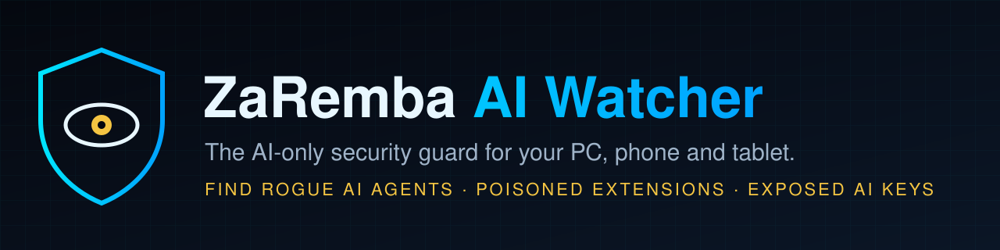
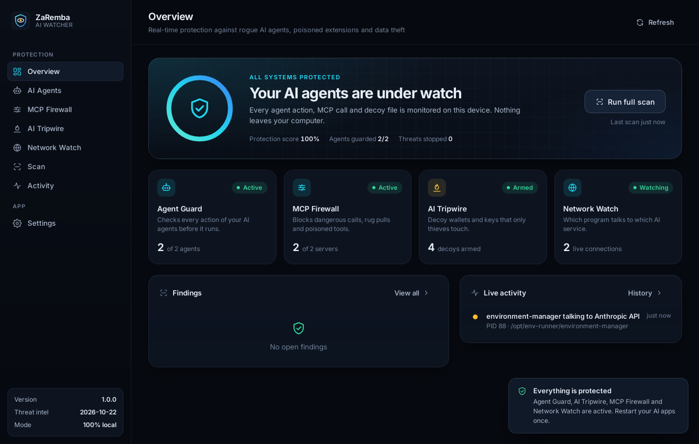
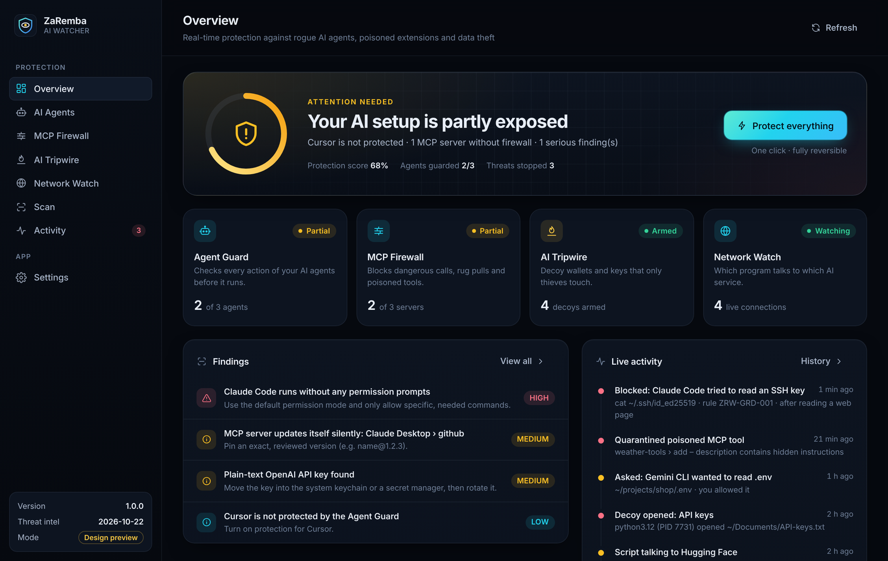
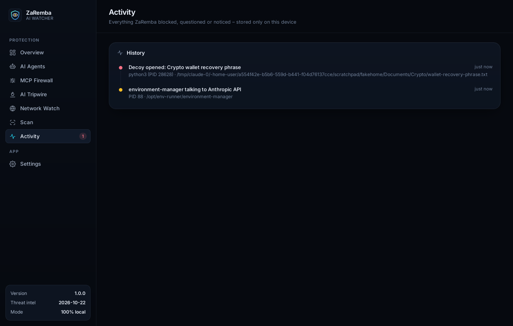
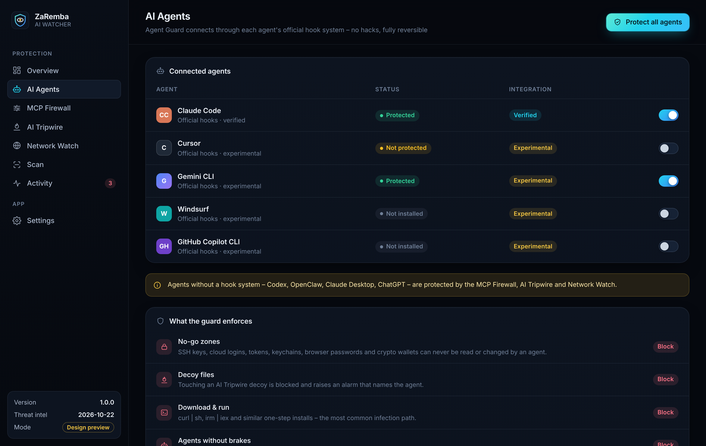
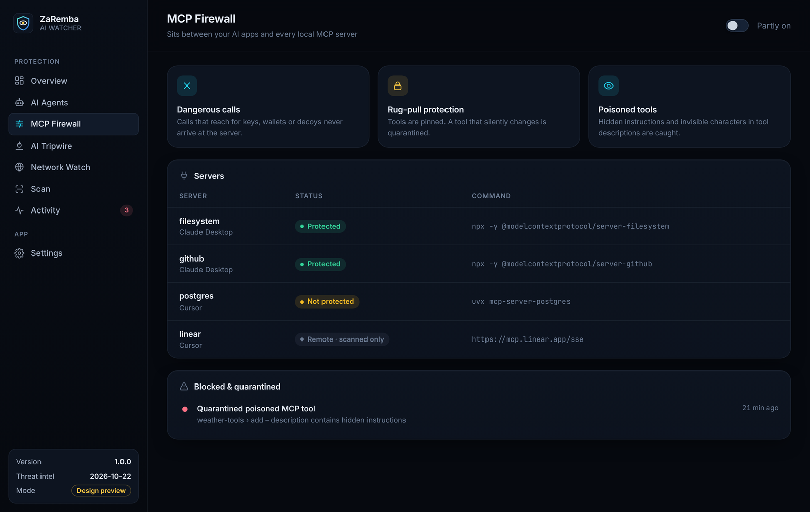
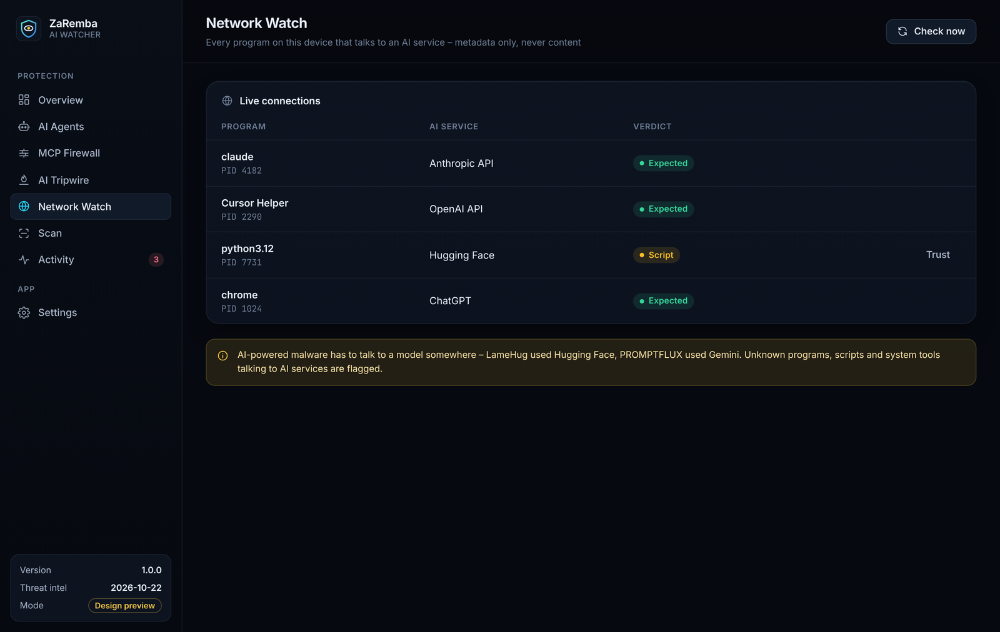
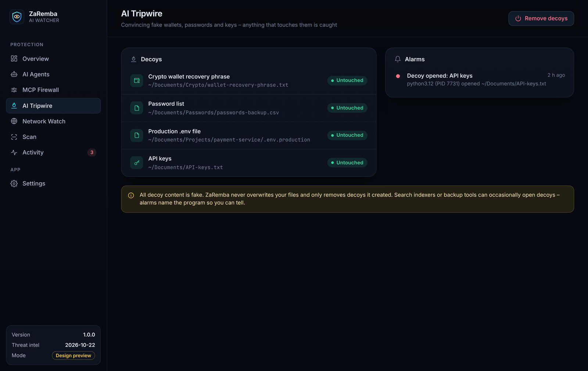

<p align="center">
  
</p>

<p align="center">
  <a href="https://github.com/kayzaa/ZaRemba-AI-Watcher-Official/releases/latest"></a>
  
  
  
  
</p>

<p align="center">
  <b>Your antivirus looks for viruses. ZaRemba looks for AI that turns against you.</b><br>
  Rogue AI agents · poisoned MCP servers · malicious agent skills · stolen AI keys · AI-driven supply-chain attacks
</p>

<p align="center">
  <a href="#%EF%B8%8F-the-desktop-app">Desktop app</a> ·
  <a href="#-download">Download</a> ·
  <a href="#-quick-start">Quick start</a> ·
  <a href="#%EF%B8%8F-what-it-protects-you-from">What it detects</a> ·
  <a href="ROADMAP.md">Roadmap</a> ·
  <a href="docs/DETECTIONS.md">Detection rules</a> ·
  <a href="PRIVACY.md">Privacy</a> ·
  <a href="#-faq">FAQ</a>
</p>

<p align="center">
  
  <br><sub><b>ZaRemba AI Watcher 1.0 desktop app</b> – one click and every AI agent, MCP server and decoy is under watch.</sub>
</p>

---

## ⚡ Why ZaRemba exists

AI assistants and agents now live on our computers. They can read files, send e-mails, run commands and install
extensions. Attackers noticed – and the first real attacks have already happened:

| When | What happened |
|---|---|
| **Jul 2025** | **LameHug** – state-backed malware that asks an AI model, live, which commands to run on the victim's PC to steal documents. ([Google GTIG](https://cloud.google.com/blog/topics/threat-intelligence/threat-actor-usage-of-ai-tools)) |
| **Aug 2025** | **s1ngularity / Nx** – a poisoned npm package made the AI coding assistants installed on developer machines hunt for wallets, SSH keys and tokens. Thousands of secrets leaked. ([Wiz](https://wiz.io/blog/s1ngularity-supply-chain-attack)) |
| **Sep 2025** | **postmark-mcp** – the first malicious MCP server: an AI e-mail extension that secretly copied every message to an attacker. ([The Hacker News](https://thehackernews.com/2025/09/first-malicious-mcp-server-found.html)) |
| **Nov 2025** | **PROMPTFLUX** – malware that asks an AI to rewrite its own code every hour to dodge antivirus scanners. ([Google GTIG](https://cloud.google.com/blog/topics/threat-intelligence/threat-actor-usage-of-ai-tools)) |
| **Jan–Feb 2026** | **ClawHavoc** – hundreds of malicious "skills" for the popular OpenClaw agent installed password stealers and targeted crypto wallets. ([SC World](https://www.scworld.com/news/openclaw-agents-targeted-with-341-malicious-clawhub-skills)) |
| **2026** | Hidden instructions on web pages hijack AI browsers and assistants (*prompt injection*) – now seen in the wild. ([CSA](https://labs.cloudsecurityalliance.org/research/csa-research-note-indirect-prompt-injection-in-the-wild-2026/)) |

Classic antivirus was built for files with fixed fingerprints. AI threats rewrite themselves, hide inside trusted
assistants and abuse permissions you granted. **ZaRemba AI Watcher is built only for this new kind of threat.**

---

## 🖥️ The desktop app

One window for everything: a live protection score, one-click protection, real-time alerts and a full history – in a
calm, dark interface that stays out of your way and lives in your tray.

<table>
  <tr>
    <td width="50%"><br><sub><b>Overview</b> – the protection score shows exactly what is still exposed. One click fixes it.</sub></td>
    <td width="50%"><br><sub><b>Live alarms</b> – a program opened a decoy wallet. ZaRemba names it instantly.</sub></td>
  </tr>
  <tr>
    <td><br><sub><b>AI Agents</b> – Claude Code, Cursor, Gemini CLI, Windsurf and Copilot CLI protected through their official hooks.</sub></td>
    <td><br><sub><b>MCP Firewall</b> – dangerous calls, rug pulls and poisoned tools never reach your AI.</sub></td>
  </tr>
  <tr>
    <td><br><sub><b>Network Watch</b> – which program talks to which AI service, right now.</sub></td>
    <td><br><sub><b>AI Tripwire</b> – fake wallets, passwords and keys that only thieves touch.</sub></td>
  </tr>
</table>

<sub>Some screens show sample data for illustration.</sub>

---

## 📥 Download

### 🖥️ Desktop app (recommended)
| System | Download | |
|---|---|---|
| 🪟 **Windows 10 / 11** | [**ZaRemba-AI-Watcher-windows-x64-setup.exe**](https://github.com/kayzaa/ZaRemba-AI-Watcher-Official/releases/latest/download/ZaRemba-AI-Watcher-windows-x64-setup.exe) | or [.msi](https://github.com/kayzaa/ZaRemba-AI-Watcher-Official/releases/latest/download/ZaRemba-AI-Watcher-windows-x64.msi) for company rollouts |
| 🍎 **macOS** – Apple Silicon | [**ZaRemba-AI-Watcher-macos-apple-silicon.dmg**](https://github.com/kayzaa/ZaRemba-AI-Watcher-Official/releases/latest/download/ZaRemba-AI-Watcher-macos-apple-silicon.dmg) | macOS 11+ |
| 🍎 **macOS** – Intel | [**ZaRemba-AI-Watcher-macos-intel.dmg**](https://github.com/kayzaa/ZaRemba-AI-Watcher-Official/releases/latest/download/ZaRemba-AI-Watcher-macos-intel.dmg) | macOS 11+ |
| 🐧 **Linux** | [AppImage](https://github.com/kayzaa/ZaRemba-AI-Watcher-Official/releases/latest/download/ZaRemba-AI-Watcher-linux-x64.AppImage) · [.deb](https://github.com/kayzaa/ZaRemba-AI-Watcher-Official/releases/latest/download/ZaRemba-AI-Watcher-linux-x64.deb) | |
| 📱 Android · iPhone · iPad | — | Planned – see [roadmap](ROADMAP.md) |

Install, click **Protect everything** – done. ZaRemba keeps itself and its threat intelligence up to date automatically
(signed updates only). Step-by-step help: **[Installation guide](docs/INSTALL.md)**.

### ⌨️ Command line (for developers, CI and servers)
| System | Download |
|---|---|
| 🪟 Windows (64-bit) | [`zaremba-windows-x64.zip`](https://github.com/kayzaa/ZaRemba-AI-Watcher-Official/releases/latest/download/zaremba-windows-x64.zip) |
| 🍎 macOS – Apple Silicon | [`zaremba-macos-apple-silicon.tar.gz`](https://github.com/kayzaa/ZaRemba-AI-Watcher-Official/releases/latest/download/zaremba-macos-apple-silicon.tar.gz) |
| 🍎 macOS – Intel | [`zaremba-macos-intel.tar.gz`](https://github.com/kayzaa/ZaRemba-AI-Watcher-Official/releases/latest/download/zaremba-macos-intel.tar.gz) |
| 🐧 Linux (64-bit) | [`zaremba-linux-x64.tar.gz`](https://github.com/kayzaa/ZaRemba-AI-Watcher-Official/releases/latest/download/zaremba-linux-x64.tar.gz) |

Every release lists **SHA-256 checksums** so you can verify your download.

---

## 🚀 Quick start

**Windows (PowerShell)**
```powershell
cd $HOME\Downloads
Expand-Archive zaremba-windows-x64.zip -DestinationPath zaremba
.\zaremba\zaremba.exe scan
```

**macOS / Linux (Terminal)**
```bash
cd ~/Downloads
tar -xzf zaremba-*.tar.gz
./zaremba scan
```

Useful commands:
```text
zaremba scan                       Show problems only
zaremba scan --all                 Full AI inventory: every agent, MCP server and skill
zaremba scan -p ~/code/my-project  Also check a project folder (.mcp.json, .env, packages)
zaremba scan --json                Machine-readable report (for scripts and CI)

zaremba tripwire install           Lay out decoy wallets, passwords and API keys (all fake)
zaremba tripwire watch             Live alarm the moment a decoy is touched
zaremba tripwire status            Check whether any decoy was changed or deleted
zaremba tripwire remove            Remove the decoys again

zaremba net                        Which programs are talking to AI services right now?
zaremba net watch                  Keep watching and report every new program
zaremba net allow "my-tool"        Trust a program you know

zaremba guard install              Real-time protection for Claude Code, Gemini CLI, Cursor, Windsurf, Copilot CLI
zaremba mcp protect                Put the MCP Firewall in front of every local MCP server
zaremba update                     Download the latest signed threat intelligence
```
Guides: **[Agent Guard](docs/AGENT_GUARD.md)** · **[MCP Firewall](docs/MCP_FIREWALL.md)** (new in 0.4) ·
**[AI Tripwire](docs/TRIPWIRE.md)** · **[AI Network Watch](docs/NETWORK_WATCH.md)**

Example result:
```text
[CRITICAL] Known malicious MCP server: Cursor › email (postmark-mcp)
    Unofficial MCP server impersonating Postmark. From version 1.0.16 it silently
    BCC'd every e-mail sent through it to an attacker address.
    What to do: Remove this server from the config now, then change every password
    and API key it could reach.

[HIGH] Claude Code runs without any permission prompts
    What to do: Use the default permission mode and only allow specific, needed commands.

[MEDIUM] Plain-text OpenAI API key found  (sk-pro…(33 chars))
    What to do: Move the key into the system keychain or a secret manager, then rotate it.

Summary: 1 critical · 1 high · 1 medium · 0 low · 7 inventory items
```

Exit codes for scripts and CI: `0` nothing to fix · `1` issues found · `2` critical threat found.

---

## 🛡️ What it protects you from

| Area | ZaRemba checks | Status |
|---|---|---|
| 🧭 **AI Inventory** | Which AI agents, assistants and local models are on your device (Claude Code, Claude Desktop, Cursor, Windsurf, GitHub Copilot, Cline, Roo Code, Continue, Gemini CLI, Codex CLI, Amazon Q, OpenClaw, Ollama, LM Studio …) | ✅ Available |
| 🔌 **MCP server audit** | Known malicious servers · servers that silently auto-update · unencrypted remote servers · AI keys stored in plain text | ✅ Available |
| 🧩 **Skill & plugin audit** | Known malicious skills · skills that download and run code · password-protected "installer" archives | ✅ Available |
| ⚙️ **Risky agent settings** | Agents allowed to act with **no permission prompts** or with the sandbox switched off | ✅ Available |
| 🔑 **Exposed AI keys** | OpenAI, Anthropic, Google AI, Hugging Face, OpenRouter and GitHub keys lying in shell profiles and `.env` files | ✅ Available |
| 📦 **Poisoned packages** | Known malicious npm packages (global and in your projects) | ✅ Available |
| 🪤 **AI Tripwire** | Decoy wallets, passwords and keys that only thieves touch – instant alarm, names the program on Linux | ✅ Available (0.2) |
| 🌐 **AI Network Watch** | Shows which program talks to which AI service (OpenAI, Anthropic, Gemini, Hugging Face, DeepSeek … and local Ollama/LM Studio) and flags unknown or suspicious ones | ✅ Available (0.3) |
| 🛑 **Real-time Agent Guard** | Checks every action of Claude Code, Gemini CLI, Cursor, Windsurf and GitHub Copilot CLI before it runs – blocks access to wallets, SSH keys, cloud logins and browser passwords, download-and-run and more | ✅ Available (0.4) |
| 🔥 **MCP Firewall** | Sits between any AI app and its MCP servers: blocks dangerous calls, catches rug pulls and poisoned tool descriptions | ✅ Available (0.4) |
| 🖥️ **Desktop app** | One-click protection, live score, tray icon, notifications, signed automatic updates | ✅ Available (1.0) |
| 🧠 **Daily threat intelligence** | A research team adds newly disclosed malicious MCP servers, skills and packages every day – signed, delivered automatically | ✅ Available (1.0) |
| 📱 **Mobile & browser** | Android app, browser extension against hidden AI instructions, iPhone/iPad protection | 🗓️ Planned |

Full list with rule IDs: **[Detection rules](docs/DETECTIONS.md)** · What comes next: **[Roadmap](ROADMAP.md)**

---

## 🔒 Privacy by design

- **Runs 100 % on your device.** No account, no cloud upload, no telemetry.
- **Read-only scan.** `zaremba scan` never changes, deletes or moves your files. AI Tripwire only creates its own decoy
  files. Agent Guard and MCP Firewall only add their own entries to your AI apps' settings, keep a backup, and remove
  them again exactly.
- **Secrets stay secret.** Keys are never printed – only a short redacted hint like `sk-pro…(33 chars)`.
- **Nothing about you is sent.** ZaRemba only *downloads*: signed app updates and the signed threat database from this
  GitHub repository, and DNS lookups of public AI service names for Network Watch. No uploads, no telemetry.

Details: **[Privacy policy](PRIVACY.md)**

---

## 🗺️ Roadmap at a glance

```text
 ✅ v0.1  AI Inventory Scanner
 ✅ v0.2  AI Tripwire (decoy files)
 ✅ v0.3  AI Network Watch
 ✅ v0.4  Real-time Agent Guard + MCP Firewall
 ✅ v1.0  Desktop app · automatic updates · daily threat intelligence   ← you are here
 🔨 v1.1  Code-signed installers · read-detection on Windows & macOS
 🗓️ v1.x  Browser extension · Android · iPhone/iPad
```

Follow progress in the **[full roadmap](ROADMAP.md)** and the **[changelog](CHANGELOG.md)**.
⭐ **Star this repo** and click **Watch → Custom → Releases** to get notified about every new version.

---

## ❓ FAQ

<details>
<summary><b>Is this an antivirus? Do I still need my normal one?</b></summary>

Keep your normal antivirus. ZaRemba is a specialist that adds what classic scanners miss: threats that live inside AI
agents, their extensions and their permissions.
</details>

<details>
<summary><b>Is it free?</b></summary>

Yes. The scanner is free for personal use. See the [license](LICENSE).
</details>

<details>
<summary><b>Why is the source code not here?</b></summary>

This repository hosts the official, ready-to-use builds, documentation and roadmap. Development happens in a separate
private repository.
</details>

<details>
<summary><b>Windows says "Windows protected your PC" / macOS says the app can't be checked.</b></summary>

The installers are not yet code-signed with a Microsoft/Apple certificate (planned for v1.1). Verify the SHA-256
checksum from the release page, then follow the [installation guide](docs/INSTALL.md#first-launch-warnings).
App updates are always signed with ZaRemba's own release key and verified before installing.
</details>

<details>
<summary><b>Does it work on my phone?</b></summary>

Not yet. Android is planned. On iPhone and iPad, Apple does not allow apps to scan other apps, so protection there will
focus on browser, links and media. See the [roadmap](ROADMAP.md).
</details>

<details>
<summary><b>It flagged something I trust. What now?</b></summary>

Open a [false-positive report](https://github.com/kayzaa/ZaRemba-AI-Watcher-Official/issues/new?template=false_positive.yml).
We review every report.
</details>

---

## 🤝 Help make AI safer

- 🐞 [Report a bug](https://github.com/kayzaa/ZaRemba-AI-Watcher-Official/issues/new?template=bug_report.yml)
- 🎯 [Report a false positive](https://github.com/kayzaa/ZaRemba-AI-Watcher-Official/issues/new?template=false_positive.yml)
- ☠️ [Report a malicious AI extension, skill or package](https://github.com/kayzaa/ZaRemba-AI-Watcher-Official/issues/new?template=threat_report.yml)
- 💡 [Suggest a feature](https://github.com/kayzaa/ZaRemba-AI-Watcher-Official/issues/new?template=feature_request.yml)
- 🔐 Found a vulnerability in ZaRemba itself? Please follow the [security policy](SECURITY.md) – do not open a public issue.

---

<p align="center">
  <sub>ZaRemba AI Watcher is a defensive tool. It does not guarantee complete protection; no security product can.
  Always keep your system, browser and antivirus up to date.<br>
  Made by <a href="https://github.com/kayzaa">trader.lifestyle · Indicator Genius</a>.</sub>
</p>
